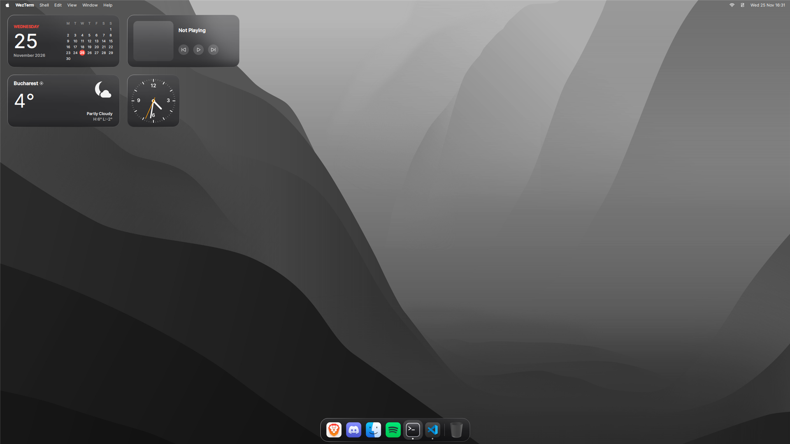
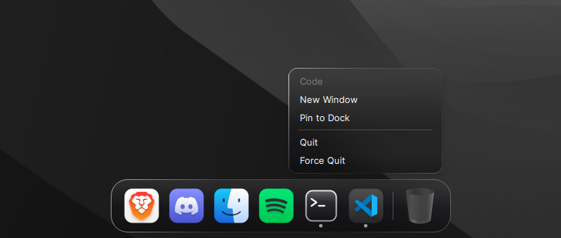
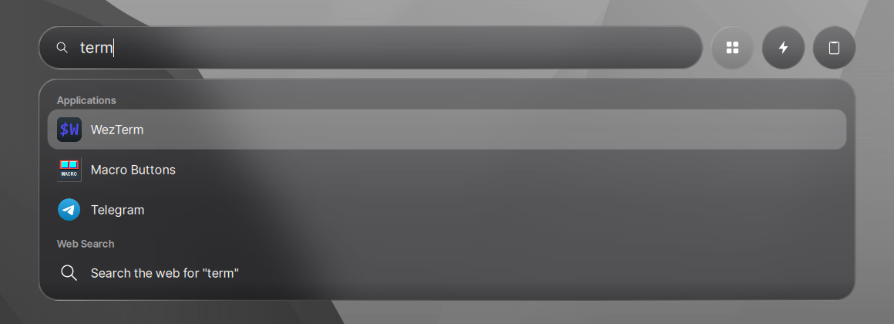
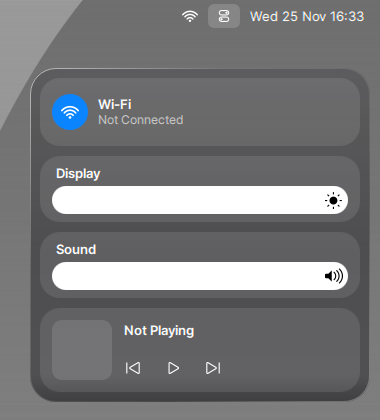

# ElWice



A liquid glass desktop for Windows 11 that swaps the taskbar for a macOS-style dock, top bar and StandBy widgets.


## Contents

- [About](#about)
- [Features](#features)
- [Install](#install)
- [Usage](#usage)
- [Make it yours](#make-it-yours)
- [Build](#build)
- [Uninstall](#uninstall)
- [Troubleshooting](#troubleshooting)
- [Contributing](#contributing)
- [Credits](#credits)

## About

ElWice borrows the look of macOS and iOS without pretending to be either. Everything is dark smoked glass. A top bar sits over your wallpaper, StandBy-style widgets live on the bare desktop, and a glass dock fully replaces the Windows taskbar. The terminal matches the rest. The icons are drawn SVGs, not emoji.

ElWice is the Windows port of [ElRice](https://github.com/infectedwarelol/ElRice), [@infectedwarelol](https://github.com/infectedwarelol)'s Arch Linux / GNOME rice, hence the name. The shell runs on the [Windows port of Quickshell](https://github.com/nunreasonable/quickshell-windows), so the whole UI is plain QML you can edit live. A small Rust installer sets everything up and can undo all of it again.

| Dock menu | Spotlight | Control Center |
| --- | --- | --- |
|  |  |  |

## Features

- **Dock instead of the taskbar.** The Windows taskbar is hidden on every monitor, and the dock takes its place. The dock shows your pinned apps, then your other open windows, then a divider, the tray arrow and the trash, which is always last. It hides itself and slides up when you move the mouse to the bottom edge.
- **Right-click menu on dock apps.** The menu has New Window, Pin to Dock / Unpin from Dock, Show in Explorer, Quit and Force Quit:
  - **Quit** closes every window of the app, so apps can still ask you to save.
  - **Force Quit** asks for a second click, then ends the app and all of its processes.
  - **Pins** are saved to `standby.json`.
- **Background apps.** The arrow after the divider opens your tray icons in a glass popup. Left click opens an app, right click shows its own menu, and scrolling works too.
- **Top bar.** A glass bar with the Apple menu, the focused app's menus, Wi-Fi, Control Center and the clock.
- **Control Center.** Wi-Fi, display brightness, volume and Now Playing.
- **Spotlight.** Tap the Windows key to search apps, do quick maths or fall back to a web search. Ctrl+Esc still opens the Start menu.
- **Alt+Tab.** A glass app switcher.
- **StandBy widgets.** Calendar, Now Playing, weather and an analog clock sit on the desktop behind your windows. Now Playing follows any app that shows up in Windows media controls.
- **The rest of the look.** Dark mode with transparency, the ElWice wallpaper, a WezTerm config on acrylic glass with the fastfetch Apple logo, and macOS-style sounds.

## Install

You need Windows 11 22H2 or newer, the [Rust toolchain](https://rustup.rs) and winget.

```powershell
git clone https://github.com/theprodogy/ElWice
cd ElWice\installer
cargo build --release
target\release\elrice.exe install
```

The installer does the following:
- Pulls in [quickshell-windows](https://github.com/nunreasonable/quickshell-windows) v0.3.2-win2 to `%LOCALAPPDATA%\Programs\Quickshell` if it isn't there yet. The download script is checked against a pinned SHA-256.
- Backs up every setting it is about to change.
- Copies the shell to `%LOCALAPPDATA%\quickshell\elrice`.
- Sets up the wallpaper, dark mode, fonts, sounds and terminal.
- Adds an autostart entry.

> [!IMPORTANT]
> Tray icons only work while User Account Control is on. Quickshell refuses to take over the tray when it runs as admin, and with UAC off every app runs as admin. To turn UAC on, set the slider in "Change User Account Control settings" to anything above "Never notify", then reboot.

## Usage

ElWice starts on its own at login. To start it by hand, run `qs -c elrice`.

| Action | How |
| --- | --- |
| Open Spotlight | Tap the Windows key |
| Start menu | Ctrl+Esc |
| Switch apps | Alt+Tab / Alt+Shift+Tab |
| Show the dock | Move the mouse to the bottom edge |
| App menu | Right-click an app in the dock |
| Cycle a pinned app's windows | Scroll over its dock icon |
| Tray icons | Click the arrow after the dock divider |

## Make it yours

| What | Where |
| --- | --- |
| Weather city and unit | `standby.json` (`city`, `unit`) |
| Dock apps | `standby.json` (`dock`), or right-click an app and pick Pin to Dock |
| Widgets, dock, bar | `shell/*.qml` |
| Glass and blur | `shell/defaults/windows/layerrules.json` |
| Keybinds | `shell/defaults/windows/keybinds.json` |
| Terminal | `~/.config/wezterm/wezterm.lua`, written by `installer/src/terminal.rs` |
| Terminal logo | `fastfetch/config.jsonc` |
| Wallpaper | `wallpaper/wallpaper.jpg` |

> [!TIP]
> While working on the shell, install with `elrice.exe install --live`. The installed shell then links to your clone's `shell/` folder instead of copying it. Every save reloads the running shell, and you never have to reinstall.

## Build

The installer and its two helpers are one Cargo package:

```powershell
cd installer
cargo build --release
cargo clippy --release
```

That gives you three programs in `target\release`:
- `elrice.exe` is the installer.
- `taskbar.exe` keeps the Windows taskbar hidden. It only wakes up when Windows tries to show the taskbar, so it uses no CPU otherwise. It brings the taskbar back when the shell exits.
- `altwatch.exe` tells the Alt+Tab switcher when Alt is released.

## Uninstall

```powershell
cd ElWice\installer
target\release\elrice.exe revert
```

This does the following:
- Shows the taskbar again.
- Restores every backed-up setting: registry values, wallpaper, fonts and sounds.
- Removes the autostart entry, the WezTerm config and `%LOCALAPPDATA%\quickshell\elrice`.

Quickshell itself stays installed. To remove it too:

```powershell
& "$env:LOCALAPPDATA\Programs\Quickshell\install.ps1" -Uninstall
```

## Troubleshooting

- **The taskbar is back.** The shell has stopped. Start it again with `qs -c elrice`.
- **The weather card says "Weather unavailable".** The weather comes from wttr.in, so check that `curl https://wttr.in` works on your network.
- **No glass.** Blur needs the Windows 11 transparency effects switched on.
- **The tray arrow is missing.** It hides itself while there are no tray icons. See the UAC note under [Install](#install).
- **WezTerm warns about a missing font.** Install JetBrainsMono Nerd Font with `winget install DEVCOM.JetBrainsMonoNerdFont`.
- **Nothing shows up.** Run `qs -c elrice` in a terminal to see the QML errors.

## Contributing

Issues and pull requests are welcome. Please keep it to one change per pull request, and test it with `elrice.exe install --live` on a real Windows 11 machine. Rust changes need a clean `cargo clippy --release`.

## Credits

- Original rice by [@infectedwarelol](https://github.com/infectedwarelol/ElRice). Windows port by [@theprodogy](https://github.com/theprodogy).
- Built on [Quickshell](https://quickshell.org) and its Windows port by [nunreasonable](https://github.com/nunreasonable/quickshell-windows).
- Terminal logo by [fastfetch](https://github.com/fastfetch-cli/fastfetch). Weather from [wttr.in](https://wttr.in). UI font: [Inter](https://rsms.me/inter/).
- Dock icons from [WhiteSur-icon-theme](https://github.com/vinceliuice/WhiteSur-icon-theme) by vinceliuice (GPL-3.0, see `shell/icons/dock/`).
